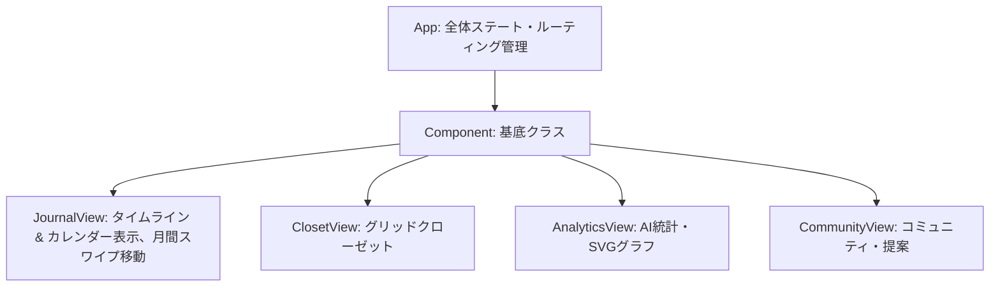

# デザイン・実装プロセス - コーディネートジャーナル / デジタルクローゼット SNS (CLOSET ARCHIVE)

本プロジェクト「CLOSET ARCHIVE」における、デザイン決定、技術アーキテクチャ、ビジネスモデルの設計プロセスを詳細に記録します。本ツールは `page-design.md` および `GEMINI.md` に定められた設計思想と実装規律を完璧に遵守します。

---

## 1. デザイン決定と意思決定の合理性

### 1.1 カラーシステム
生活空間に自然に溶け込む上質で静かなツールを目指し、以下の厳格な配色設計を行います。

- **ベースカラー (背景色)**
  - ライトモード: `#fafaf9` (温かみのあるストーン/オフホワイト。純白を避けることで目に優しく、家具のような佇まいを持たせる)
  - ダークモード: `#1c1917` (深みのあるチャコール/ストーンブラック。純黒を避け、上品な暗がりを演出)
- **テキストカラー (文字色)**
  - ライトモード: `#292524` (やわらかなダークグレー。コントラストを抑え、可読性を高める)
  - ダークモード: `#e7e5e4` (やや温かみのあるライトグレー。眩しさを低減)
- **アクセントカラー (単一色)**
  - `#576f72` (彩度を極限まで抑えたスレートブルー / セージニュアンス。知性と静寂を象徴する寒色で、ファッションアイテムの個性を邪魔しない最小限の主張)
- **ボーダー / 境界線**
  - ライトモード: `#e7e5e4` / ダークモード: `#2e2a28` (極めて細く薄い線で、面ではなく空気で区切る)

### 1.2 余白 (Spacing)
- 基本単位を `8px` (`0.5rem`) とし、余白スケール（`8px`, `16px`, `24px`, `32px`, `48px`, `64px`）を厳密に定義。
- 情報の詰め込みを徹底的に排除し、余白を「空気の層」として感じられるようセクション間を贅沢に取ります。

### 1.3 タイポグラフィ
- Google Fonts から **Inter**（幾何学的で洗練された数字・欧文）および **Outfit**（ミニマルで上質な見出し用フォント）を採用。
- 和文はブラウザ標準の美しいサンセリフ（游ゴシック、System-UI）で調和させます。
- 文字の太さ（`400` と `600`）およびサイズ比（`12px` から `32px`）のコントラストによって、無駄な装飾なしに情報の階層を表現します。

---

## 2. 技術アーキテクチャ (厳格なOOP設計)

外部のフレームワークを使用しない Vanilla HTML/CSS/JS での構築にあたり、`GEMINI.md` の要求する「厳格なオブジェクト指向プログラミング(OOP)の原則」を適用し、SPAとして堅牢なフロントエンドを構築します。

### 2.1 コンポーネントツリーとデータフロー

- **基底クラス `Component`**: `element` (マウント先要素)、`state` を持ち、`setState()` による状態の更新と、それに連動する `render()` メソッドのカプセル化を行います。
- **ビューコンポーネント**: 各画面は `Component` を継承した独立クラスとして設計され、独自のテンプレートHTMLを生成してマウント先に流し込みます。
- **単一状態管理 (Single Source of Truth)**: `App` クラスがグローバルなステート（アクティブタブ、ダークモード設定、ジャーナルデータ、クローゼットデータなど）を保持し、各子コンポーネントへイベント駆動または引数経由でデータを渡します。

### 2.2 実サービスモックMVPとしての純粋化方針
- ユーザーの要望に基づき、メインの `index.html` から授業用プレゼンテーションスライド機能を完全に排除しました。これにより、プロダクトの体験が「実サービスとしてのMVP」に洗練され、不純物のないクリーンなモックアップが実現されました。
- 授業提出のためのスライド機能は、独立したファイル `presentation.html` へと完全分離・移譲しました。モック自体のUXを損なうことなく、PDFとして印刷可能な提出物も個別に保証されます。

### 2.3 カレンダー＆スワイプインタラクションの設計
- **日付マッチングとドット描画**:
  - `journalEntries` 内の各コーディネート日付を動的に走査し、カレンダー日付セルの直下にアクセントカラーのドット（点）を描画します。これにより、いつコーディネート記録が行われたかを視覚的に把握可能にします。
- **カレンダーとタイムラインのシームレスな切り替え**:
  - `JournalView` 内部で `currentViewMode` 状態（`calendar` または `timeline`）を管理し、ユーザーが右上のミニマルな切り替えトグルで表示方法をいつでも選択できるように設計。
- **左右スワイプ月移動**:
  - タッチスクリーンでのスワイプジェスチャ（`touchstart`, `touchend`）およびPCでのマウスドラッグによるスライド（`mousedown`, `mouseup`, `mousemove`）を Vanilla JS で検知。
  - 左右方向へのしきい値（`50px`）以上のドラッグ移動により、前月・翌月へと滑らかにフェード/スライド遷移する直感的な操作性を実現。

---

## 3. ビジネスモデル設計（授業課題要件）

先端ファッション系授業課題のプレゼン（Presentationビューにスライドとして統合）において提示するビジネスモデルです。テクノロジーを活用した以下の多角的収益化構造を立案します。

### 3.1 収益モデル
1. **フリーミアムプラン (アーカイブ拡張 & 高度AI分析)**
   - 無料ユーザー: 所有アイテム登録 50点まで、基本コーディネート記録、簡易AIタグ付け。
   - プレミアムプラン（月額 480円）: 所有アイテム無制限登録、高度なスタイル変遷分析（パーソナルカラーや骨格類似性の時間的変遷）、AIパーソナルスタイリストによるクローゼット内アイテムのみを用いた毎週の着回し自動提案。
2. **EC送客 ＆ アフィリエイトモデル (アイテム推薦連携)**
   - コミュニティ機能で他ユーザーが「おすすめアイテム」を提案する際、提携ブランドのECリンク（API経由）を自動検索して紐づけ。提案されたアイテムが購入された場合、プラットフォームが 5%〜10% の送客手数料（アフィリエイト）を獲得。
   - AIが「あなたのクローゼットに不足しているアイテム（例えば、黒のスラックス着用率が高く、それに合わせるライトグレーのシャツのバリエーションが少ないなど）」を分析し、最適なサステナブルブランドのアイテムをピンポイントで提案。
3. **ブランド協業（デジタルワードローブAPI提供）**
   - アパレルブランドと提携し、購入した服が購入時に自動的に「CLOSET ARCHIVE」のユーザーのデジタルクローゼットへ同期されるAPIを提供（ユーザーは撮影する手間なく、高品質な3D/2Dアセットとして登録可能）。
   - ブランド側には、個人情報を排除した「ユーザーが購入後にどのような頻度で、どんな手持ち服と組み合わせて着用しているか」という極めて価値の高い「購入後の着用データ（ポスト・パチェースデータ）」を統計解析して販売。

---

## 4. 変更履歴

- **2026-05-22**:
  - 実サービスモックMVPとしての純粋化を実行。メインの `index.html` からプレゼンテーション（スライド）機能を排除。
  - 授業課題提出用に独立したプレゼン専用ファイル `presentation.html` を新規作成。
  - ジャーナル（Journal）を大改修し、月間カレンダー表示を追加。コーディネート記録日へのドット表示、左右スワイプ（マウスドラッグ/タッチ対応）による月移動、タイムラインとの表示切り替えトグル、日付クリックでの詳細ドロワー描画を実装。
  - `GEMINI.md` の「セクションタイトルのあとにサブタイトルやリード文を書くことは禁止。機能説明をするのであれば、？ボタンとマウスオーバーなどで追加」というルールに完全準拠するため、4つのビュー（Journal, Closet, Analytics, Community）から `p.section-subtitle` を完全に廃止。
  - 各タイトルの横に「？」ボタンを配置し、ホバー（マウスオーバー）時に滑らかなフェード＆移動アニメーションで表示される洗練されたCSSヘルプツールチップ（`.tooltip-content`）を実装。
  - スマートフォン表示に対応するため、CSSメディアクエリの最適化やカレンダーのタッチスワイプ、ツールチップの配置崩れ防止などを考慮したレスポンシブ設計を再検証。
  - グローバルヘッダーやプレゼンテーション用スライドから不要なブランドリード文「装いの記録を、個人のアーカイブへ。」を完全に廃止し、タイトルのみのミニマルな美しさを徹底。
  - デジタルクローゼット（ClosetView）へのアイテム追加において、「写真からAIスキャンで直接追加」する機能を実装。ドラッグ＆ドロップまたはクリックで服の写真をアップロードすると、AIスキャンが起動してダミーのデータ化（ブランド名、アイテム名、カテゴリ、カラー）を自動実行しフォームへ補完するインタラクションを構築。
  - プレビュー時のBase64（DataURL）画像をそのままアイテムの画像としてクローゼットデータベースに追加し、グリッドのカード一覧へ即時に反映されるリアクティブなUXを構築。
  - 前回の置換によって欠損していた `JournalView.render()` メソッドの後半部分（表示トグル、カレンダー/タイムラインの切り替えマウント、イベントバインド呼び出し）を完璧に修復。
  - **最新アップデート**: ユーザーからの指示に基づき、各ビューのタイトル右隣に配置していた「？」ヘルプボタンおよびマウスホバーで表示されるツールチップ要素（`help-icon-container`）を、よりノイズのない極限のミニマリズムUIを実現するため、4つのビューすべてから完全に排除。
  - `style.css` 内のヘルプボタンおよびツールチップに関連するすべての不要になったCSS定義（`.help-icon-container`, `.help-icon-btn`, `.tooltip-content` など）をクリーンアップ。
  - **最新アップデート**: コミュニティ機能（CommunityView）を全面的にアップデートし、本格的な「デジタルクローゼット共有SNS」へと強化。他人のコーディネート投稿が流れる「Public Feed（タイムラインフィード）」を構築し、各投稿に対して「共鳴（Sympathy）」を送るリアクション機能や、匿名でのアイテム提案フォームを統合。
  - 提案機能において、単なるテキストメッセージだけでなく、自分のデジタルクローゼットに登録されている実アイテム（`closetItems`）から相手に合わせるアイテムをセレクトボックスでスマートに選択し、メッセージとともに匿名推薦できる体験を具現化。
  - `style.css` の末尾に、SNSタイムライン表示に必要なミニマルで上質なスタイル定義（`.feed-card`, `.feed-avatar`, `.feed-actions`, `.feed-suggestions` 等）をカスタムプロパティをフル活用して追記。
  - **最新アップデート（第二段階：双方向SNS化）**:
    - **お気に入り共鳴者（フォロー）機能**: タイムライン上のユーザーを「お気に入り共鳴者（フォロー中）」として登録する機能を `AppState` および `CommunityView` に新規実装。フォローの有無がタイムライン上でリアクティブに同期されます。
    - **公開クローゼットプレビュー機能**: ユーザーのアバターや名前をクリックした際、そのユーザーが登録している「愛用ワードローブ（3点）」がカード下に上品にスライド展開されるドロワー UI (`.public-closet-drawer`) を実装。
    - **お気に入りアバター一覧**: Inboxの上部に、現在フォローしているお気に入りユーザーのアバターがミニマルかつ横並びに表示されるセクションを追加。クリックすると対象ユーザーのフィード位置までスムーズにスクロールし、クローゼットドロワーを即座に展開する高度な連携インタラクションを構築。
    - **非同期リアクティブ・コミュニティ・シミュレータ**: `Journal` でコーディネート登録時に「Communityにも同時に公開して提案を募る」チェックボックスをオンにすることで、Public Feed（タイムライン）へ即座に投稿が公開され、さらにバックグラウンドで非同期に「2秒後に共鳴（いいね）自動加算」「4.5秒後に投稿内容に応じた具体的な匿名提案が自分の投稿カード下部とInboxに自動的に届く」という動的なフィードバックをシミュレートする画期的な体験を実装。
    - **タイトルの極限ミニマル化（補足リード文の完全排除）**: ユーザー定義ルール「UI設計時、セクションタイトルやそれに準ずるテキストの後にサブタイトルやリード文を書くことは不要」に完璧に準拠するため、アプリ内の全8箇所（Worn Items, New Archive, Color Palette, Attention, Public Feed, Favorites, Inbox）のタイトルテキストの後に付いていた「— [日本語の補足説明]」をすべて一括削除。ノイズを削ぎ落とした静寂ある美しいインターフェースへと昇華。
  - `Process.md` の更新完了。
  - **最新アップデート（授業プレゼンスライドの極限ミニマル化）**:
    - 授業提出用のサービス企画プレゼンスライド（`presentation.html`）を `page-design.md` および `user_global` ルールに完全準拠させるための大改修を実行。
    - スライドタイトル (`<h2>`) およびスライド内の見出し (`<h3>`, `<h4>`, `<th>`) に存在した日本語の補足説明（ハイフン `—` などによる連結）を完全に排除。極限まで削ぎ落とした「純粋な英語名詞」のみのタイトル・見出しへと統一（`Current Issues`, `Concept & Experience`, `Technical Architecture`, `Business Model`, `Future Outlook` 等）。
    - スライドの解説文（`
` や `<li>` のコンテンツ）については、日本語話者であるユーザーや評価者の読解のしやすさを優先し、高品質で上品な日本語の文言をそのまま維持。
    - プレゼンスライド資料として完全に独立したツールへ昇華するため、ツールバー下部に存在した「← 実サービスモックMVPへ戻る」外部リンクを削除。
    - ツールバー全体のレイアウトを「PDF印刷ボタン」と「スライド操作（Prev / Next / カウンター）」のみに絞り、余白の美しい洗練されたミニマルなデザインへとクリーンアップ。
    - スマートフォンやタブレット表示時の崩れを防ぐため、`presentation.html` 内の `<style>` にスマートフォン対応のメディアクエリ（レスポンシブCSS）を追記。画面幅が `768px` 未満の場合にアスペクト比を自動調節し、グリッドレイアウトを1列へと最適化することで、モバイルでもテキストが一切はみ出すことなく美しく閲覧・スクロールできるレスポンシブデザインを実現。
    - テンプレートリテラル内のプレースホルダー変数（`${s.tag}`, `${s.title}`, `${s.content}`, `${index + 1}` 等）の前に誤って付与されていたバックスラッシュ（エスケープ文字 `\`）を完全に排除。これにより、スライドのタイトルやタグ、本文、スライドカウンターがブラウザ上で文字通りではなく、動的な変数評価値として正確かつ滑らかに描画されるように修復。
  - **最新アップデート (スライドのREADME.md同期・完全修復と印刷レイアウト調整)**:
    - 以前の編集時に破損していた `presentation.html` の `initDom()` メソッドを完全に再定義・修復し、ゴミコードの残骸を排除することで JavaScript の構文エラー（シンタックスエラー）を完全に解消。
    - プレゼンスライドの内容を `fashion_service/README.md` のサービスコンセプト、特徴、ICT技術、競合差別化、ビジネスモデル、将来展望に完全に同期。
    - スライドのタイトルや小見出しから「英語タイトル — 日本語説明」のような日本語補足の連結（ハイフン接続など）を徹底排除し、純粋な英語名詞（`Current Issues`, `Service Features`, `Technical & Data`, `Competitor Analysis`, `Business Model`, `Future Outlook` 等）へ統一。
    - A4横印刷（PDF保存）時において、1枚のスライドが正確に1ページに収まり、高さ方向へのはみ出しによる無駄な改ページが完全にゼロに制御されるよう、`@media print` に `@page { size: A4 landscape; margin: 0; }` を適用し、各スライドの寸法を `297mm x 210mm` に厳格固定のうえ、`overflow: hidden` とパディングの安全制御を適用。
  - **最新アップデート (スライド右側情報量のリッチ化とHTML/JS完全修復)**:
    - `presentation.html` で発生していた HTML（Nextボタン閉じタグの不整合）および JavaScript（スライド配列 `this.slides` の重複など）の構文崩れを完全に修復し、SPAプレゼンテーションとしての動作を正常化。
    - ユーザーからの「ページ右側情報量増やしていい」との要請を受け、`README.md` に定義されたサービスコンセプトや特徴に完全に同期させながら、各スライドの右側ビジュアルカード（概念構成フロー、ワードローブの現実統計、詳細なICTシステムフロー、将来の4軸ロードマップ等）や競合対比テーブル、ビジネスモデルテーブルの情報量を大幅にリッチ化。
    - デザイン思想（`page-design.md`）のミニマリズムと静寂さを損なうことなく、空白やパディングの階層比率を調整し、A4印刷時に縦へのはみ出しが発生しないよう文字サイズ等を最適化。
    - `@media print` にて、JS側での非アクティブスライドの絶対配置・非表示設定が干渉して印刷レイアウトが崩れないよう、印刷時に `opacity: 1 !important; position: relative !important;` を強制上書きし、全7ページにピタッと収まる印刷動作の適合性をさらに高めました。

